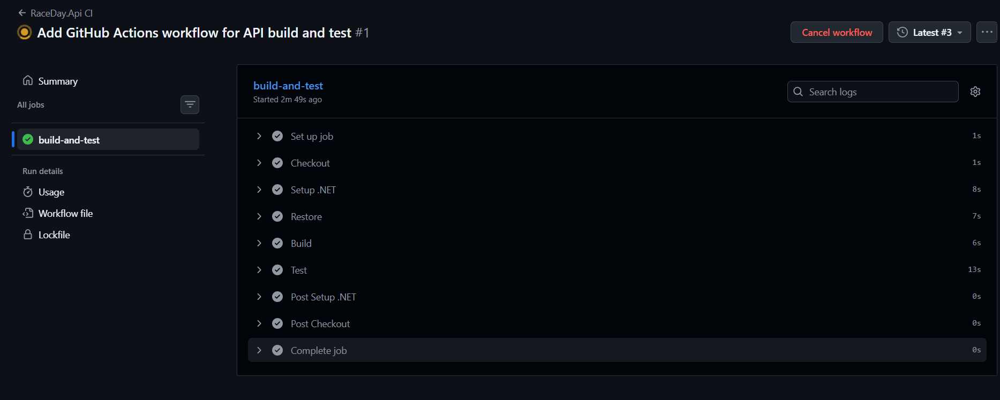
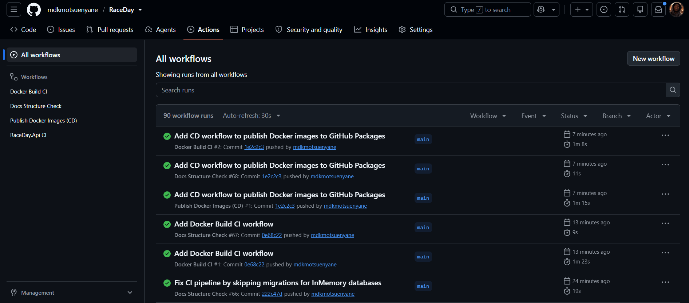
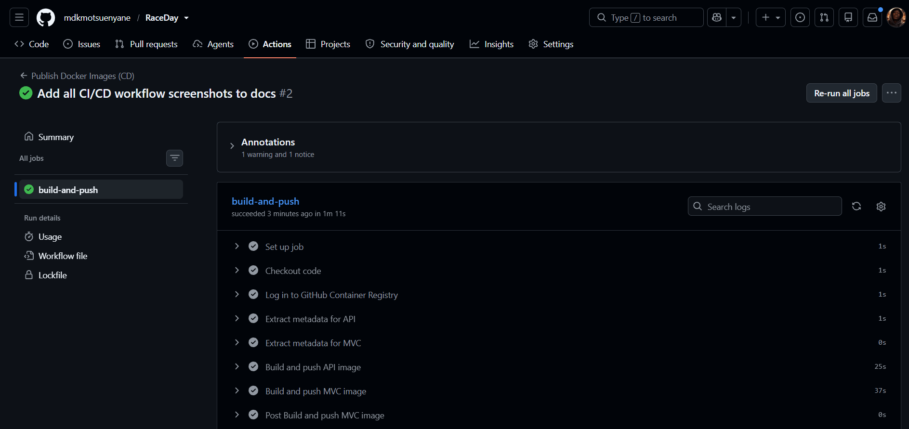

# iNDLELA (RaceDay Architecture)


---

## Overview

**iNDLELA** (The Path) is a full-stack event management platform designed specifically for the South African road running, walking, and cycling community. 

> *Note: The technical codebase, API, and database are named `RaceDay` as per the project specification. However, the user-facing platform has been branded as **iNDLELA** to create a strong, energetic sporting identity, fulfilling the UI/UX branding requirements of the module.*

This repository contains a complete **Full-Stack** solution:
1. **RaceDay.Api**: A RESTful **ASP.NET Core Web API** back-end built with Entity Framework Core and SQL Server.
2. **RaceDay.Mvc**: An **ASP.NET Core MVC** front-end that consumes the API, managing state via Session and JWTs.

▶️ **Demo Video Part 1 (Planning):** [Watch on YouTube](https://youtu.be/i0hwWwrlrA4)

▶️ **Demo Video Part 2 (API):** [Watch on YouTube](https://youtu.be/mqsA6EGXBHw)

▶️ **Demo Video Part 3 (Front-End & Docker):** (up soon)

---

## 👥 User Roles & Permissions

The system implements strict Role-Based Access Control (RBAC) via JWT (API) and Session Cookies (MVC).

### 1. Organiser
*   **Dashboard:** View a summary of all created events and total enrolments.
*   **Event Management:** Create, edit, and delete events. Upload event banner images (Azure Blob Storage) and input weather/route data.
*   **Category Management:** Create custom race categories (age, distance, gender) for each event.
*   **Enrolments:** View all participants who have entered their events and update their entry status.
*   **Results:** Upload finish times and positions for participants after the race.

### 2. Participant
*   **Event Browsing:** View all upcoming events with search/filtering options.
*   **Registration:** Enter races by selecting a specific category and pay/confirm their entry.
*   **My Entries:** View personal registrations and withdraw if necessary.
*   **My Results:** View personal race history, including finish times and overall placement (e.g., 47th out of 312).
*   **Profile:** Update personal details and upload a profile picture.

---

## 🏗️ Development Status

| Component | Status |
| :--- | :---: |
| Database Design (SQL) & ERD | ✅ Complete |
| API Endpoint Plan | ✅ Complete |
| Entity Models (EF Core) & Migrations | ✅ Complete |
| Authentication (JWT & Session) | ✅ Complete |
| API Controllers Implementation | ✅ Complete |
| API Unit Tests (xUnit) | ✅ Complete (53 tests) |
| CI/CD (GitHub Actions) | ✅ Complete |
| Front-end Integration (MVC) | ✅ Complete |
| Azure Blob Storage Integration | ✅ Complete |
| UI Styling & Theming (iNDLELA) | ✅ Complete |
| Containerisation (Docker) | ✅ Complete |

---

## 💻 Technology Stack

| Component | Technology |
| :--- | :--- |
| **Framework** | .NET 10 (LTS) |
| **API Architecture** | ASP.NET Core Web API (RESTful) |
| **Front-end Architecture** | ASP.NET Core MVC |
| **ORM** | Entity Framework Core 10 |
| **Database** | Microsoft SQL Server (LocalDB for dev) |
| **Authentication** | JWT (JSON Web Tokens) + Session Cookies |
| **Cloud Storage** | Azure Blob Storage (with local file fallback) |
| **API Documentation** | Swagger / OpenAPI (Swashbuckle) |
| **Password Hashing** | BCrypt.Net |
| **Unit Testing** | xUnit (53 integration tests) |
| **CI/CD** | GitHub Actions |
| **Containerisation** | Docker & Docker Compose |

---

## 🐳 Docker Setup

The application is fully containerised. The API, MVC front-end, and SQL Server database can be started with a single command.

### Prerequisites
- [Docker Desktop](https://www.docker.com/products/docker-desktop/) must be installed and running.

### Run the application
Navigate to the root of the repository (where `docker-compose.yml` is located) and run:

```bash
docker compose up --build
```

### Access the containers
- **iNDLELA Web App:** http://localhost:7159
- **API Swagger:** http://localhost:7100/swagger

*(Note: The API automatically applies Entity Framework migrations and seeds test data on startup, ensuring the database is ready immediately).*

---

## 🔐 Environment Configuration & Azure Blob Storage

This project follows security best practices by **never committing secrets to source control**.

### How the Storage works
The `BlobService` is designed with a fallback strategy:
- **Local Development with Azure:** If a valid `AzureStorage:ConnectionString` is provided in `appsettings.Development.json` (gitignored) or User Secrets, images are uploaded to Azure Blob Storage.
- **Fallback (No Keys):** If the connection string is missing (e.g., in Docker), the application gracefully falls back to saving images locally in the `wwwroot/uploads` folder.

To test with your own Azure Storage, create an `appsettings.Development.json` in the `RaceDay.Api` folder and add:
```json
{
  "AzureStorage": {
    "ConnectionString": "YOUR_AZURE_CONNECTION_STRING",
    "ContainerName": "event-images"
  }
}
```

---

## 🚀 Getting Started (Local Development)

### Prerequisites
- [Visual Studio 2022](https://visualstudio.microsoft.com/)
- [.NET 10 SDK](https://dotnet.microsoft.com/download)
- [SQL Server Express LocalDB](https://learn.microsoft.com/en-us/sql/database-engine/configure-windows/sql-server-express-localdb)

### 1. Clone the Repository
```bash
git clone https://github.com/mdkmotsuenyane/RaceDay.git
cd RaceDay
```

### 2. Configure the Database & JWT Secret
Open `RaceDay.Api/appsettings.json` and ensure the connection string points to your LocalDB. Then, set your JWT secret via User Secrets:
```bash
cd RaceDay.Api
dotnet user-secrets init
dotnet user-secrets set "Jwt:Key" "<your-32-plus-char-random-secret>"
```

### 3. Apply Database Migrations
```bash
dotnet ef database update -p RaceDay.Api -s RaceDay.Api
```

### 4. Run the Application
Because the MVC app consumes the API, **both projects must run simultaneously**.
1. In Visual Studio, right-click the **Solution** node.
2. Select **Configure Startup Projects...**
3. Choose **Multiple startup projects**.
4. Set both `RaceDay.Api` and `RaceDay.Mvc` to **Start**.
5. Click **OK** and press **F5**.

- **API Swagger:** `http://localhost:5100/swagger`
- **iNDLELA Web App:** `http://localhost:5103`

---

## 🧪 Testing & Continuous Integration / Deployment (CI/CD)

The API has **53 passing integration tests** covering all controllers, using `WebApplicationFactory<Program>` and isolated in-memory databases.

### Automated Workflows
This repository is equipped with 4 distinct GitHub Actions workflows to ensure code quality and deployment readiness:

1. **API CI (`api-ci.yml`):** Restores, builds, and runs all 53 xUnit tests on every push.
2. **Docker CI (`docker-ci.yml`):** Validates that both the API and MVC Docker images build successfully.
3. **CD Publish (`cd-publish.yml`):** Builds and pushes the production Docker images to GitHub Container Registry (ghcr.io).
4. **Docs Check (`docs-check.yml`):** Verifies that documentation files are present and formatted.

### Successful Build Screenshots

Here is proof of the workflows passing:

**1. API Unit Tests Passing (53 Tests)**


**2. Docker Build Pipeline Passing**


**3. Continuous Deployment (Publishing Images)**


Run tests locally with:
```bash
dotnet test RaceDay.slnx
```

---

## ⏭️ Project Milestones (Completed)

1. ~~Implement JWT Authentication (API).~~ ✅
2. ~~Build all API controllers matching the plan.~~ ✅
3. ~~Write unit/integration tests for API endpoints.~~ ✅
4. ~~Build the MVC front-end that consumes the API.~~ ✅
5. ~~Integrate Azure Blob Storage for image uploads.~~ ✅
6. ~~Polish UI with custom Bootstrap theme (iNDLELA).~~ ✅
7. ~~Containerise the application with Docker.~~ ✅

---

## 📃 License & Contributors

This project is built for educational purposes as part of the PROG6212 module for Rosebank International.

## ✍🏾 Author

- Mokadi Motsuenyane
