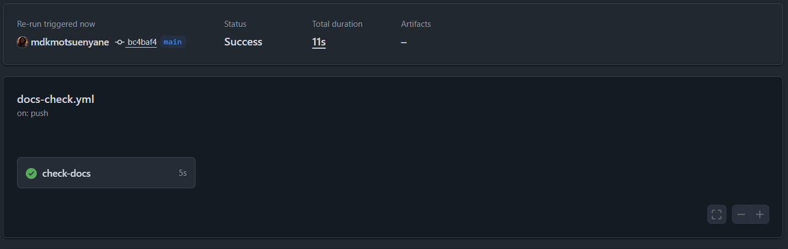

# RaceDay 

> **🚧 WORK IN PROGRESS – ACADEMIC PROJECT**  
> This project is currently in active development as part of the PROG6212 module. It is not yet deployed to production. Features, endpoints, and schema are subject to change until final submission.

---

## Overview

RaceDay is a full‑stack event management platform designed specifically for the South African road running, walking, and cycling community. 

From the iconic **Comrades Marathon** and **Two Oceans Marathon** to the **Cape Town Cycle Tour** and **Soweto Marathon**, the platform allows Event Organisers to create and manage events, categories, and participant results, while Participants can browse upcoming events, enter races, track their personal performance history, and prepare for race day using live weather and route information.

This repository contains the **ASP.NET Core Web API** back‑end, built with **Entity Framework Core** and **SQL Server**. The front‑end (MVC) will be built in a later phase.

▶️ **Demo Video:** [Watch on YouTube](https://youtu.be/i0hwWwrlrA4)

---

## 🏗️ Development Status

| Component | Status |
| :--- | :---: |
| Database Design (SQL) | ✅ Complete |
| ERD | ✅ Complete |
| API Endpoint Plan | ✅ Complete |
| Entity Models (EF Core) | ✅ Complete |
| Database Migrations | ✅ Complete |
| Authentication (JWT) | ✅ Complete |
| Controllers Implementation | ✅ Complete |
| Swagger Documentation | ✅ Complete |
| Unit Tests | ⏳ In Progress |
| CI/CD (GitHub Actions) | ⏳ In Progress |
| Front‑end Integration | ⏳ Future Phase |
| Containerisation (Docker) | ⏳ Future Phase |
| Cloud Deployment | ⏳ Future Phase |

---

## 🔥 Features Implemented

- **Authentication & Authorisation** – JWT‑based Register/Login/Refresh for Organisers and Participants.
- **User Profiles** – Unified profile management for both roles via `GET/PUT /api/v1/users/me`.
- **Event Management** – Full CRUD for events, including race day details (weather, route, maps).
- **Category Management** – Create categories per event (e.g. "Men Open", "Ultra Marathon") with age/gender restrictions.
- **Registration (Entries)** – Participants can enter events, with status tracking (Pending/Confirmed/Cancelled).
- **Results** – Organisers can upload results (finish times, positions, chip/gun times) and participants can view their performance.
- **Race Day Preparation** – Weather forecasts and route information integrated directly into event details.

---

## 💻 Technology Stack

| Component | Technology |
| :--- | :--- |
| **Framework** | .NET 10 (LTS) |
| **API Architecture** | ASP.NET Core Web API (RESTful) |
| **ORM** | Entity Framework Core 10 |
| **Database** | Microsoft SQL Server (LocalDB for dev) |
| **Authentication** | JWT (JSON Web Tokens) |
| **API Documentation** | Swagger / OpenAPI (Swashbuckle) |
| **Password Hashing** | BCrypt.Net |
| **Unit Testing** | xUnit (planned) |
| **Containerisation** | Docker (Future) |
| **Cloud** | Azure / AWS compatible (Future) |

---

## Getting Started (Development Environment)

### Prerequisites

- [Visual Studio 2022](https://visualstudio.microsoft.com/) (with ASP.NET and web development workload)
- [.NET 10 SDK](https://dotnet.microsoft.com/download)
- [SQL Server Express LocalDB](https://learn.microsoft.com/en-us/sql/database-engine/configure-windows/sql-server-express-localdb) (installed with Visual Studio's ASP.NET workload)
- [SQL Server Object Explorer](https://learn.microsoft.com/en-us/sql/ssms/) (built into Visual Studio)

### 1. Clone the Repository

```bash
git clone https://github.com/mdkmotsuenyane/RaceDay.git
cd RaceDay
```

### 2. Configure the Connection String

Open `RaceDay.Api/appsettings.json` and set `DefaultConnection` for your environment:

```json
{
  "ConnectionStrings": {
    "DefaultConnection": "Server=(localdb)\\MSSQLLocalDB;Database=RaceDayDB;Trusted_Connection=True;TrustServerCertificate=True;MultipleActiveResultSets=True;"
  },
  "Jwt": {
    "Key": "DEV_PLACEHOLDER_REPLACE_WITH_USER_SECRETS",
    "Issuer": "RaceDay.Api",
    "Audience": "RaceDay.Clients",
    "ExpiresInSeconds": 86400
  }
}
```

### 3. Configure JWT Secret (User Secrets)

The real JWT signing key is stored outside the repo using .NET user secrets:

```bash
cd RaceDay.Api
dotnet user-secrets init
dotnet user-secrets set "Jwt:Key" "<your-32-plus-char-random-secret>"
```

Generate a random key with PowerShell:

```powershell
[Convert]::ToBase64String((1..48 | ForEach-Object { Get-Random -Maximum 256 }))
```

### 4. Restore, Build, and Migrate

```bash
dotnet restore
dotnet build
dotnet ef database update
```

This creates the `RaceDayDB` database and applies the `InitialCreate` migration, giving you all 7 tables: `User`, `Organiser`, `Participant`, `Event`, `Category`, `Entry`, `Result`.

### 5. Run the API

```bash
cd RaceDay.Api
dotnet run
```

Or press **F5** in Visual Studio.

Swagger UI opens automatically at `https://localhost:7100/swagger`.

---

## API Endpoint Plan

The complete API endpoint plan (39 endpoints) is documented in [`/docs/API_Plan.pdf`](./docs/API_Plan.pdf). It covers:

- Authentication (Register, Login, Refresh)
- User Profiles
- Organisers CRUD
- Participants CRUD
- Events CRUD (including Weather & Route sub‑endpoints)
- Categories CRUD
- Entries (Registrations) CRUD
- Results CRUD

### Try It Out

1. Run the API and open Swagger.
2. `POST /api/v1/auth/register` to create a user.
3. `POST /api/v1/auth/login` to get a JWT.
4. Click **Authorize** in Swagger, paste the token.
5. All protected endpoints now work.

---

## Database Schema (ERD)

The Entity Relationship Diagram is available at [`/docs/RaceDayERD.png`](./docs/RaceDayERD.png).

Core entities:

- **User** – Authentication and base profile (1‑to‑1 with Organiser or Participant).
- **Organiser** – Creates and manages Events.
- **Participant** – Enters Events via Entries.
- **Event** – Contains weather and route details for race day prep.
- **Category** – Distances, age groups, and gender restrictions per Event.
- **Entry** – Junction table linking Participants to Events/Categories.
- **Result** – Tied to an Entry for finish times and positions.

---

## 📁 Project Structure

```
RaceDay/
├── .github/
│   └── workflows/            # CI workflows (docs-check.yml, api-ci.yml)
├── docs/                     # Planning artifacts: API_Plan.pdf, RaceDayERD.png, screenshots
├── RaceDay.Api/              # ASP.NET Core Web API project
│   ├── Controllers/          # API endpoints (8 controllers)
│   ├── Data/                 # RaceDayDbContext
│   ├── DTOs/                 # Request/response shapes
│   ├── Migrations/           # EF Core migrations
│   ├── Models/               # EF Core entities
│   ├── Program.cs            # App configuration (EF Core, JWT, Swagger)
│   └── appsettings.json
├── RaceDay.Api.Tests/        # xUnit test project (in progress)
├── RaceDay.slnx              # Solution file
└── README.md
```

---

## ⚙️ Continuous Integration

A `docs-check.yml` GitHub Actions workflow runs on every push to `main`, verifying that the project's documentation stays in sync with the repo.

An `api-ci.yml` workflow will build and test the API on every push (in progress).



---

## ⚠️ Known Limitations (Work in Progress)

- ⏳ Unit tests not yet written for all endpoints.
- ⏳ CI workflow for the API not yet added.
- ❌ No front‑end application yet.
- ❌ No containerisation or deployment configuration.
- ✅ Database schema and migrations are complete and stable.

---

## ⏭️ Next Milestones

1. ~~Implement JWT Authentication.~~ ✅
2. ~~Build all controllers matching the API plan.~~ ✅
3. ~~Test all endpoints via Swagger.~~ ✅
4. Write unit tests for API endpoints (xUnit).
5. Add GitHub Actions workflow for build + test.
6. Build the MVC front‑end that consumes the API.
7. Containerise with Docker.

---

## 📃 License

This project is built for educational purposes as part of the PROG6212 module for Rosebank International.

---

## ✍🏾 Contributors

- Mokadi Motsuenyane – ST10480772 Group 3

## What Changed vs. the Original
```
| Section | Change |
|---|---|
| Development Status | Auth, Controllers, Swagger moved from "Planned" to "✅ Complete" |
| Technology Stack | .NET 8 → **.NET 10**, added BCrypt, xUnit row |
| Getting Started | Added JWT user-secrets setup; corrected connection string to LocalDB; added `dotnet ef database update` |
| API Endpoint Plan | Added a "Try It Out" walkthrough |
| Project Structure | Expanded to show `RaceDay.Api/` and `RaceDay.Api.Tests/` |
| CI section | Noted `api-ci.yml` (in progress) |
| Known Limitations | Removed duplicate block; removed items now done |
| Next Milestones | Struck through completed items; listed remaining |
```
## Push It

```powershell
cd C:\Users\kholo\source\repos\RaceDay-Repo
git add README.md
git commit -m "Update README: JWT auth and controllers now complete"
git push
```

## Then — Test Project

You'll notice the README now promises a `RaceDay.Api.Tests/` project. Time to create it:

1. **File → Add → New Project**
2. Search: `xUnit Test Project` — **Language: C#** (watch that dropdown this time)
3. Name: `RaceDay.Api.Tests`
4. Location: `C:\Users\kholo\source\repos\RaceDay-Repo\`
5. Framework: .NET 10
6. Create

Then add project reference + packages per the last message, and tell me when it's ready. I'll send the test files.
